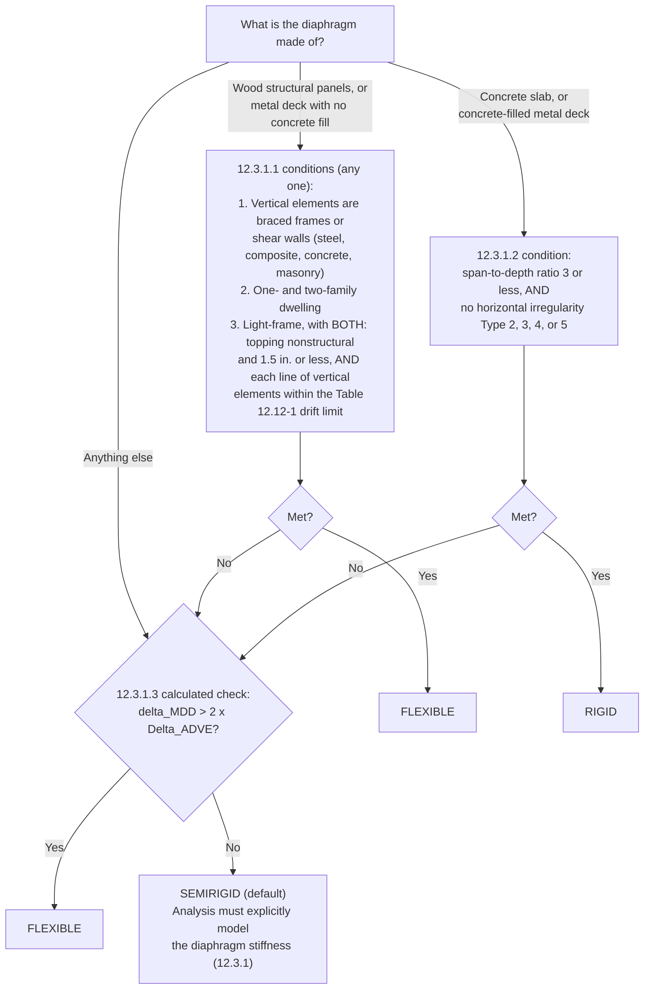

# Diaphragms, Chords, Collectors, and Wall Anchorage

This file covers the top half of the lateral trace: how seismic load gets
from the diaphragm into the vertical elements of the SFRS. It covers
diaphragm design forces (F_px), flexible / rigid / semirigid
classification, force distribution and torsion, chords, collectors (drag
struts) and their overstrength demand, connection forces, and out-of-plane
wall anchorage (F_p, k_a) with subdiaphragms and crossties. Read it when
tracing any diaphragm level, when a wall or frame line is shorter than the
diaphragm, at any opening, re-entrant corner, or offset, and wherever heavy
walls hang on a diaphragm. Material-specific detailing lives in `wood.md`,
`steel.md`, `concrete.md`, and `masonry.md`; the system and coefficient
basis lives in `seismic_design_basis.md`.

## The load-path view: diaphragm to vertical element

- The SFRS is horizontal elements plus vertical elements that together
  carry lateral load to the foundation. The **diaphragm** is the
  horizontal element: a large, thin element loaded in its own plane,
  acting as a **horizontal deep beam** whose reactions are the vertical
  elements (shear walls, braced frames, moment frames).
- **Chords** are diaphragm boundary elements **perpendicular** to the
  force; they carry the beam's bending as a tension-compression couple.
- **Collectors** (drag struts, struts) are diaphragm boundary elements
  **parallel** to the force; they gather diaphragm shear and deliver it to
  the vertical element.
- The same member is a chord in one direction and a collector in the
  other, so every boundary member gets checked twice.
- ASCE 7-22 §12.1.3 requires a **continuous, interconnected path** from
  the point of load application to the foundation.

### Three ways diaphragm shear can enter a vertical element

Every vertical element in the SFRS needs one of these, shown and detailed
in both directions:

1. **Direct contact over the element's full length**: the diaphragm edge
   is fastened to the wall or frame along its whole length (e.g. boundary
   nailing to a wall top plate, slab cast with or doweled to a concrete
   wall, deck welded to a frame beam). The shear transfer fastening has to
   be called out, not implied.
2. **Collector**: where the element is shorter than the diaphragm depth
   along that line, a continuous collector runs the full diaphragm depth
   and drags the shear into the element.
3. **Drag strut across a gap**: where the element is not on the diaphragm
   edge or is separated from it (interior wall line, frame bay offset from
   the slab edge), a strut carries the force across to it.

A vertical element with none of these is not part of the load path no
matter what the calcs assign to it. Placing a wall under a diaphragm is
contact, not connection.

### Discontinuities that need a shown chord and/or collector path

The diaphragm is a beam, so anywhere its depth, edge, or support line
changes, the beam forces need a detailed path around the change.
ASCE 7-22 §12.10.1 requires that at openings and re-entrant corners the
design show the chord (edge) forces are dissipated or transferred within
the diaphragm's shear and tension capacity.

- **Re-entrant corners**: the chord of one wing must continue (collector
  or strap) into the other wing far enough to develop its force; the
  corner itself sees a stress concentration.
- **Openings** (stairs, shafts, skylights, atriums): chords along each
  side of the opening and collectors past its ends, developed into the
  diaphragm beyond.
- **Offset wall lines** (in plan, or a wall above not lined up with the
  wall below): the diaphragm at that level carries a **transfer force**
  between vertical elements (§12.10.1.1); see F_px below.
- **Stepped diaphragms** (split levels, changes in roof or floor
  elevation): the chord and collector forces must be carried across the
  step by a detailed element; diaphragms at different elevations are not
  continuous just because they meet at a beam or wall.

### What to check on the drawings / calcs

- For each diaphragm level and each direction, list every vertical SFRS
  element and name how it receives shear: direct contact (with the
  fastening called out), collector, or drag strut. Flag any element with
  no named mechanism.
- Confirm the calcs' distribution of shear to each wall or frame line
  matches what the drawings can actually deliver to it.
- At every re-entrant corner, opening, offset wall line, and diaphragm
  step, find the plan callout or detail that carries the chord and
  collector forces across it. Flag any discontinuity with no detail.
- Confirm boundary members are identified for both directions (chord in
  one, collector in the other) and detailed for both roles.

## Diaphragm design force, F_px

**F_px = [Σ(i=x to n) F_i / Σ(i=x to n) w_i] · w_px** (ASCE 7-22
Eq. 12.10-1)

- **Limits:** F_px ≥ **0.2·S_DS·I_e·w_px** (Eq. 12.10-2) and need not
  exceed **0.4·S_DS·I_e·w_px** (Eq. 12.10-3).
- For a **one-story building**, ΣF_i / Σw_i is simply C_s.
- Diaphragms are designed for the in-plane forces from the structural
  analysis, but not less than F_px, and for **both shear and bending**
  (§12.10.1).
- **ρ = 1.0** for forces from F_px and its limits (§12.3.4.1, item 7).
  Transfer forces from offset walls are a separate case.

### w_px versus w_x

- **w_px** is the weight tributary to the diaphragm at level x: the
  diaphragm plus the **walls perpendicular to the force**. Walls parallel
  to the force are left out. It generally differs from the effective
  seismic weight w_x, which counts all walls.
- **Why:** walls parallel to the force are the diaphragm's supports; their
  own inertia goes down in-plane into their own foundations and never
  passes through the diaphragm. Walls perpendicular to the force cannot
  carry their own inertia in-plane; they span vertically between floors,
  so their tributary weight (typically half the wall height above and
  below the level) is pushed out-of-plane into the diaphragm.

### Weights included (ASCE 7-22 §12.7.2)

w_px includes the applicable portion of: 25% of storage floor live load
(not public garages or open parking); partitions at actual weight or
10 psf, whichever is greater; permanent equipment at operating weight;
**15% of uniform design snow where p_f > 45 psf**, regardless of roof
slope; landscaping at roof gardens; and **fluids and bulk material**
(may be reduced by a rational fluid-structure analysis). Storage,
equipment, landscaping, and fluids may all be left out where together
they add no more than 5% to the effective seismic weight at that level.
- ASCE 7-16 (older projects / existing reports): snow was 20% where
  p_f > 30 psf; the 5% exception applied to storage only; fluids were not
  listed.

### Transfer forces (§12.10.1.1)

- Diaphragms must also carry **transfer forces** between vertical SFRS
  elements that do not line up (e.g. a shear wall above offset from the
  one below). This is a core trace item: the diaphragm at the offset
  level has to carry the upper wall's shear over to the lower wall.
- With a **horizontal Type 4 (out-of-plane offset)** irregularity,
  transfer forces are **multiplied by Ω₀** before being added to the
  diaphragm inertial forces. Exception: one- and two-family light-frame
  dwellings may use Ω₀ = 1.0.

### 25% increase for irregularities (§12.3.3.5)

- SDC D, E, or F with **horizontal Type 1, 2, 3, or 4** or **vertical
  Type 3** (in-plane discontinuity) irregularity: increase the §12.10.1.1
  forces by **25%** at each diaphragm level where the irregularity
  occurs, for (1) connections of diaphragms to vertical elements and to
  collectors, and (2) collectors and their connections, including to
  vertical elements.
- **Not double-counted:** the 25% is not needed where those elements are
  designed with overstrength (§12.4.3). Use Ω₀ or the 25%, not both.
- ASCE 7-16 (older projects / existing reports): the in-plane
  discontinuity was numbered vertical Type 4.

### Alternative diaphragm design methods

- **§12.10.3** (diaphragm design force reduction factors): **required** for
  precast concrete diaphragms in SDC C-F; **permitted** for precast in
  SDC B, cast-in-place concrete, wood-sheathed diaphragms on wood
  framing, bare steel deck, and concrete-filled steel deck.
- **§12.10.4**: permitted for one-story structures meeting §12.10.4.1
  (flexible diaphragm on rigid walls; the two-stage procedure of
  §12.2.3.4).

### What to check on the drawings / calcs

- F_px is computed per level with w_px (perpendicular walls only), and
  the 0.2 and 0.4·S_DS·I_e·w_px bounds are checked.
- Diaphragm design uses the larger of analysis forces and F_px, and covers
  both shear and bending.
- Seismic weights follow §12.7.2 as of ASCE 7-22 (15% snow where
  p_f > 45 psf, fluids included). The 7-16 snow rule on a 7-22 project is
  a finding.
- Every offset wall line has a calculated transfer force in the
  diaphragm, amplified by Ω₀ where a horizontal Type 4 irregularity
  exists, and a drawn path for it.
- Where §12.3.3.5 applies, collectors and diaphragm-to-vertical-element
  connections carry the 25% increase, or overstrength instead, but not
  both stacked.
- Precast concrete diaphragms in SDC C-F are designed by §12.10.3.

## Diaphragm classification: flexible, rigid, or semirigid

The classification decides how load is split among the vertical elements,
so confirm it before checking any wall-line shear.

### Flexible (§12.3.1.1)

Wood structural panels or metal deck without concrete fill may
be idealized as flexible if **any one** of these is met:

1. The vertical elements are steel or composite braced frames, or
   concrete, steel, masonry, or composite shear walls. **Moment frames
   are not in this list**: an untopped deck or wood diaphragm on moment
   frames must qualify another way.
2. One- and two-**family** dwellings (dwelling units, not stories).
3. Light-frame construction where **both**: any topping over the wood
   structural panels is nonstructural and 1.5 in. or less, **and** each
   line of vertical elements meets the Table 12.12-1 allowable story
   drift.

### Rigid (§12.3.1.2)

Concrete slabs or concrete-filled metal deck with a **span-to-depth ratio
of 3 or less**, in structures with **no horizontal irregularity Type 2,
3, 4, or 5**, may be idealized as rigid. Type 1 (torsional) no longer
disqualifies a rigid diaphragm. ASCE 7-16 (older projects / existing
reports) required no horizontal irregularities at all.

### Calculated flexible (§12.3.1.3)

Any diaphragm not classified above is flexible where
**δ_MDD / Δ_ADVE > 2** (Eq. 12.3-1): the maximum in-plane diaphragm
deflection exceeds twice the average story drift of the adjoining
vertical elements below it, under the §12.8 ELF loading.

### Semirigid is the default (§12.3.1)

- A diaphragm that cannot be idealized as flexible or rigid under
  §12.3.1.1 to §12.3.1.3 must be analyzed with its **stiffness explicitly
  modeled**. Semirigid is the default, not a third option the designer
  picks.
- **"Rigid assumed" needs justification (project standard).** A drawing set or calc that
  assumes a rigid diaphragm that does not meet §12.3.1.2 (e.g. a concrete
  deck with span-to-depth > 3, or a building with a Type 2-5 horizontal
  irregularity) is a finding, unless it is shown to be flexible under
  §12.3.1.1 or §12.3.1.3.
- **Envelope is acceptable.** Per ASCE 7-22 commentary C12.3.1, running
  both a rigid and a flexible model and designing each vertical element
  for the larger force is an acceptable alternative to semirigid
  modeling. A documented rigid/flexible envelope is not a finding.
  Semirigid modeling is always permissible, even where flexible or rigid
  would qualify.
- **Open-front / cantilevered wood diaphragms are semirigid (sometimes
  rigid), never flexible.** A flexible (tributary) diaphragm has no way to
  resist the torsion a cantilever depends on. SDPWS also requires a rigid
  or semirigid assumption for some cantilever diaphragm provisions even
  where §12.3.1.1 would allow flexible (verify: SDPWS-21). An open-front
  wood diaphragm analyzed as flexible is a finding (project standard).
  See `wood.md`.
- **Hillside light-frame structures** have their own diaphragm modeling
  rules (§12.3.1.4).

### Flowchart

### Consequences of the classification

- **Distribution:** flexible diaphragms act as simple beams between the
  vertical elements and distribute by **tributary area** (§12.8.4.1: by
  the position and distribution of the masses supported), with no
  torsional redistribution. Rigid diaphragms act as a rigid plate on
  springs and distribute **in proportion to vertical-element stiffness**,
  plus inherent torsion where the center of mass (CM) and center of
  rigidity (CR) do not coincide. Semirigid distribution depends on the
  relative stiffness of diaphragm and vertical elements, so it must come
  from a model that includes the diaphragm stiffness.
- The torsional irregularity check (TIR) does not apply to flexible
  diaphragms.
- Where tabulated Ω₀ ≥ 2.5, Ω₀ may be reduced by **subtracting 0.5** (not
  halving) for structures with flexible diaphragms (Table 12.2-1
  footnote). This feeds the collector overstrength force.
- k_a for wall anchorage depends on whether the diaphragm is flexible.

### What to check on the drawings / calcs

- The diaphragm assumption is stated for each level and each direction,
  and the stated basis matches a §12.3.1 path in the flowchart.
- "Rigid" is used only for concrete or concrete-filled deck with
  span-to-depth ≤ 3 and no horizontal Type 2-5 irregularity, or is part
  of a documented rigid/flexible envelope.
- "Flexible" under condition 1 is not claimed for moment-frame
  buildings; "flexible" under condition 3 has topping ≤ 1.5 in.
  (nonstructural) and drift compliance for each line.
- Open-front or cantilevered wood diaphragms are modeled semirigid or
  rigid, not flexible.
- A reduced Ω₀ (minus 0.5) is used only where the diaphragm actually
  qualifies as flexible.
- The method used to split shear among wall lines matches the
  classification: tributary for flexible; stiffness plus torsion for
  rigid; modeled stiffness for semirigid. Tributary distribution on a
  diaphragm that does not qualify as flexible is a finding.

### Common findings

- Rigid check written as "no horizontal irregularities" (ASCE 7-16
  wording); 7-22 excludes only Types 2, 3, 4, and 5.
- Drift limit cited as "Table 12.2-1"; the drift table is Table 12.12-1
  (Table 12.2-1 is the design coefficients table).
- "One- and two-story dwellings" instead of one- and two-family
  dwellings.

## Rigid and semirigid diaphragms: torsion

### Center of mass and center of rigidity

- **CM**: where the story shear is applied.
  x_CM = Σ(w_i·x_i) / Σw_i; y_CM = Σ(w_i·y_i) / Σw_i.
- **CR**: the point the diaphragm rotates about.
  x_CR = Σ(R_y,i·x_i) / ΣR_y,i, using only walls **parallel to y**;
  y_CR = Σ(R_x,i·y_i) / ΣR_x,i, using only walls **parallel to x**.
- **Inherent eccentricity** is measured perpendicular to the shear:
  e_x = x_CR − x_CM; e_y = y_CR − y_CM.
- **Inherent torsional moment** (§12.8.4.1): **M_tx = V_x·e_y**;
  **M_ty = V_y·e_x**.
- A layout with the lateral resistance concentrated on one side of the CM
  puts a torsional increment on the opposite walls, and also ties to the
  ρ = 1.3 trigger (see `seismic_design_basis.md`).

### Accidental torsion (§12.8.4.2) and amplification (§12.8.4.3)

- Accidental eccentricity: CM shifted **±5% of the building dimension
  perpendicular to the force**: e_ay = ±0.05·L_y for V_x; e_ax = ±0.05·L_x
  for V_y. So **M_ta,x = V_x·e_ay** and **M_ta,y = V_y·e_ax**.
- For non-flexible diaphragms, accidental torsion is **always applied when
  checking whether a torsional irregularity exists** (TIR).
- It is **included in design only** where a **Type 1 torsional
  irregularity** exists:

| Condition | Accidental torsion in design? | A_x |
|---|---|---|
| No Type 1 torsional irregularity | No: design uses M_t (V·e) only | n/a |
| SDC B, Type 1 with TIR > 1.4 | Yes | 1.0 (§12.8.4.3 applies only to SDC C-F) |
| SDC C-F, any Type 1 | Yes | Computed, 1.0 to 3.0 |

- **A_x = [δ_max / (1.2·δ_avg)]²** (Eq. 12.8-15), computed per level
  with A_x = 1 assumed for the displacements; δ_avg is the average of the
  displacements at the extreme points at that level. A_x ≥ 1.0 and need
  not exceed 3.0. The diaphragm may be assumed rigid for this
  calculation. A_x multiplies only the accidental part.
- **Displacements, not drifts:** A_x uses displacements (δ_max/δ_avg);
  TIR (§12.3.2.1.1) uses story drifts (Δ_max/Δ_avg).
- Design torsional moment where accidental torsion is required:
  **V_x·(e_y ± 0.05·L_y·A_x)** and **V_y·(e_x ± 0.05·L_x·A_x)**.
  Otherwise V_x·e_y and V_y·e_x.
- ASCE 7-16 (older projects / existing reports): accidental torsion was
  included in the design of every structure with a non-flexible
  diaphragm.

### Direct and torsional shear

- **Direct shear** goes only to walls **parallel** to the force:
  **V_D,i = (R_i / ΣR_parallel)·V**.
- **Torsional shear** goes to **all** walls, parallel and perpendicular:
  **V_T,i = M_T·(R_i·d_i) / J**, with M_T the design torsional moment
  above, d_i the wall's perpendicular distance to the CR, and
  **J = Σ(R_i·d_i²) = Σ(R_x·y²) + Σ(R_y·x²)** over all walls. The larger
  J, the more torsional resistance the wall system provides.
- **Total wall shear = V_D ± V_T**; walls perpendicular to the force get
  torsional shear only. The ± comes from the free-body diagram: does the
  wall's torsional shear act with (+) or against (−) its direct shear?
- **Sign selection** (§12.8.4.3: the more severe loading for each element
  governs): where torsion adds, use +V_T with (e + 0.05·L·A_x); where it
  opposes, use −V_T with (e − 0.05·L·A_x). Same signs are right when
  e > 0.05·L·A_x; otherwise check by inspection. With zero inherent
  eccentricity, shift the CM toward each wall in turn. Moving the CM
  closer to a wall increases that wall's shear.
- Where accidental torsion is not required (no Type 1), only M_t applies
  and its sign does reduce some walls' shear.
- **Inclined walls:** R_x = R·cos²θ, R_y = R·sin²θ (θ from the x-axis);
  this simplified method ignores the x-y coupling term.
- **CR self-check:** distances d must be measured from the CR produced by
  the same rigidities. From the true CR, Σ(R_i·d_i) with sign is zero in
  each direction, so opposing walls' torsional shears balance.

### What to check on the drawings / calcs

- For rigid or semirigid diaphragms, CM and CR are computed (or come from
  a model) and the inherent eccentricity is included in each direction.
- Accidental torsion is applied in the TIR check for every non-flexible
  diaphragm, and in design only where a Type 1 irregularity exists; A_x
  is computed per level for SDC C-F with Type 1, using displacements.
- Perpendicular walls are included in J and checked for their torsional
  shear.
- Each wall's design shear uses the sign combination that gives its
  largest total; no wall takes a torsional reduction from a ±5% shift that
  was required.
- Wall rigidities in the hand calc are consistent with the wall lengths,
  heights, and materials on the drawings.

## Chord forces

- Under uniform load w_s, the diaphragm bends like a simple beam; the
  chords carry the moment as a tension-compression couple.
- **CF_x = M_x / d = w_s·x·(L − x) / (2d)**, with L = diaphragm span,
  d = diaphragm depth (distance between chords, in the direction of the
  force).
- **CF_max = w_s·L² / (8d)** at midspan. This is statics; the code
  requirement is §12.10.1 (shear and bending, with chord forces at
  openings and re-entrant corners dissipated or transferred).
- **A chord force is only real if the chord is continuous over the full
  span.** Typical chords: double top plate, rim or ledger, steel edge
  member, rebar at a slab edge. Each splice must be detailed for the chord
  force, especially near midspan where it peaks.

### What to check on the drawings / calcs

- A chord is identified on **both** edges perpendicular to the force, in
  **each** direction.
- Chord splices are detailed (straps, splice nailing, welded or bolted
  splice plates, lapped bars) with a capacity tied to the calculated chord
  force; flag any splice location near midspan with no detail.
- Where an opening, re-entrant corner, or diaphragm step interrupts a
  chord, a detail shows how the force gets around it and is developed
  into the diaphragm beyond.
- The chord depth d used in the calc matches the actual diaphragm depth
  on plan.

### Common findings

- Chord drawn but not spliced (contact, not connection).
- Chord interrupted by a stair or shaft opening with no trim chord or
  strap around it.

## Collectors (drag struts)

- Collector, drag, and strut are the same element: a boundary member
  parallel to the force that carries diaphragm shear to the vertical
  element (wall, braced frame, or moment frame).
- Where the vertical element is **shorter than the diaphragm depth**, a
  **continuous collector** runs the **full depth** of the diaphragm along
  that line, to prevent localized tearing of the diaphragm and keep
  deformations compatible.
- §12.10.2: collector elements must be provided that can transfer seismic
  forces originating elsewhere in the structure to the element providing
  the resistance.

### Collector design force (ASCE 7-22 §12.10.2.1)

**SDC C through F**: collectors, their **splices**, and their
**connections to vertical elements** are designed for the **maximum** of:

| Case | Load combinations | Forces |
|---|---|---|
| (a) | Overstrength (E_mh = Ω₀·Q_E) | From the ELF or MRSA analysis (story shear V_x) |
| (b) | Overstrength (E_mh = Ω₀·Q_E) | F_px from Eq. 12.10-1 |
| (c) | Regular load combinations (§2.3.6, no Ω₀) | Minimum F_px from Eq. 12.10-2 (0.2·S_DS·I_e·w_px) |

- **Transfer forces** (§12.10.1.1) must be included.
- **Exception, wood light-frame:** structures or portions braced
  **entirely by wood light-frame shear walls** use the regular load
  combinations with §12.10.1.1 forces, **no overstrength**. Do not flag a
  collector in such a building for missing Ω₀.
- **SDC B:** regular load combinations with the diaphragm forces;
  overstrength starts at SDC C. **SDC A** (§11.7): only §1.4 general
  structural integrity applies, so ASCE 7 Chapter 12 collector provisions do not.
- **ρ = 1.0** with overstrength combinations (§12.3.4.1). E_mh need not
  exceed **E_cl**, the capacity-limited effect (what the connected yielding
  elements can deliver).
- **Ω₀ or 25%, not both** (§12.3.3.5), and the flexible-diaphragm Ω₀
  reduction applies only where the diaphragm qualifies as flexible.

### The five links of a working collector

1. **Identified** along the line for the full diaphragm depth, not just
   over the wall or frame.
2. **Continuous**: every splice detailed for the collector force (top
   plate splices or straps over beams in wood; spliced drag members or
   lapped rebar in concrete; bolted or welded splices in steel).
3. **Load in**: the diaphragm is fastened to the collector along its
   length (boundary nailing, deck welds or screws, studs, dowels).
4. **Load out**: the collector is connected to the wall or frame at its
   end (strap to the wall top plate, drag plate to a brace gusset or
   frame beam, rebar developed into the wall).
5. **Right force level**: overstrength (or the 25% increase where it
   applies) on the collector, splices, and both end connections, except
   in wood light-frame shear wall buildings.

A collector shown on plan without links 2 through 4 is contact without
connection.

### What to check on the drawings / calcs

- Every wall or frame line shorter than the diaphragm depth shows all
  five links above; name the missing link in the finding.
- Collector forces are calculated per §12.10.2.1 (max of cases a, b, c)
  for SDC C-F, include transfer forces, and use the correct Ω₀ (flexible
  reduction only if qualified). Splices and both end connections are
  sized for that force, not the basic force.
- Collector connections at braced frames and moment frames are shown in
  the frame connection details (drag force through the gusset or beam
  connection), not left to a plan note.
- The calc uses either Ω₀ or the 25% increase on a given element, never
  both stacked, and does not apply Ω₀ in an all-wood light-frame shear
  wall building where the exception applies.
- Material-specific collector detailing: see `wood.md`, `steel.md`,
  `concrete.md`, `masonry.md`.

### Common findings

- Collector stops at the end of the wall instead of running the full
  diaphragm depth.
- Collector splice over a beam or at a hinge not detailed.
- Collector designed for the basic (Ω₀ = 1) force in SDC C-F in a non-wood
  building.
- Drag connection at a brace frame missing from the frame details.

## Connection forces and out-of-plane wall forces

- **Smaller portions tied to the structure** (§12.1.3), such as a
  projecting wing or annex: connection force **F_p = 0.133·S_DS·W_p** or
  **5% of the smaller portion's weight**, whichever is greater. Not used
  for overall SFRS design, and need not exceed the maximum force the
  system can deliver to the connection.
- **Connection to supports** (§12.1.4): each beam, girder, or truss needs
  a **positive connection** for a horizontal force **parallel to the
  member** of **5% of the dead plus live reaction**, directly to its
  support or to a slab acting as a diaphragm. Where the connection is
  through a diaphragm, the member's supporting element must also be
  connected to the diaphragm.
- **Out-of-plane forces on structural walls** (§12.11.1): walls and their
  anchorage are designed for **F_p = 0.4·S_DS·I_e·W_wall**, minimum **10%
  of the wall weight**. W_wall is typically psf (wall density ×
  thickness, e.g. a 6 in. concrete wall: 150 pcf × 0.5 ft = 75 psf).

## Wall anchorage (ASCE 7-22 §12.11.2)

**F_p = 0.4·S_DS·k_a·I_e·W_p** (Eq. 12.11-1)

- **k_a = 1.0 + L_f/100**, with **1.0 ≤ k_a ≤ 2.0**. L_f (ft) is the span
  of the **flexible** diaphragm that laterally supports the wall, measured
  between the vertical elements that support the diaphragm in the
  direction considered. k_a need not exceed 1.0 where the connection is
  not at a flexible diaphragm (L_f = 0 for rigid diaphragms).
- **Minimum:** F_p ≥ the larger of **0.2·k_a·I_e·W_p** and **5 psf × the
  wall area tributary to the anchor**.
- **W_p** is the wall weight tributary to the anchor, typically per foot
  of wall (plf), and is the **wall only** (no diaphragm weight):
  - Intermediate floor: half the story below plus half the story above.
  - Roof with a parapet: half the top story plus the full parapet.
- **Reduction for anchors below the roof:** where the anchorage is not at
  the roof and all diaphragms are not flexible, F_p may be multiplied by
  **(1 + 2z/h)/3** (z = anchor height above the base, h = roof height).
  The result must still be at least the §12.11.1 force, at least
  **0.2·W_p**, and at least 5 psf × the tributary wall area.
- **Anchor spacing > 4 ft:** the wall must be designed for bending
  between anchors.
- F_p is **strength level**; ASD uses **0.7·F_p**.
- **ρ = 1.0** for out-of-plane wall forces and their anchorage
  (§12.3.4.1, item 10). Anchorage is not designed with Ω₀.
- Wall interconnections and connections to supporting framing need
  enough strength, rotational capacity, and ductility for shrinkage,
  thermal change, and differential settlement combined with seismic
  forces.

### Concrete and masonry walls in SDC C-F (§12.11.2.2)

- **Continuous ties or struts** (crossties) between diaphragm chords
  distribute the anchorage force into the diaphragm. Diaphragm
  connections must be positive, mechanical, or welded, and extend far
  enough into the diaphragm to develop the force.
- **Subdiaphragms** may carry anchorage forces to the main crossties;
  maximum length-to-width ratio **2.5:1** (see below).
- **Steel elements** of the anchorage system: strength design forces
  × **1.4**, except anchor bolts and reinforcing steel (§12.11.2.2.2);
  typically steel straps.
- **Wood diaphragms** (§12.11.2.2.3): anchorage per SDPWS 4.1.5.1. **No
  toenails, no nails in withdrawal, no wood ledgers or framing in
  cross-grain bending or cross-grain tension.** Crossties are in addition
  to the sheathing; the sheathing is not the tie. Details in `wood.md`.
- **Metal deck** (§12.11.2.2.4): the deck cannot serve as the continuous
  tie **perpendicular to the deck span**.
- **Embedded straps** (§12.11.2.2.5): attached to or hooked around the
  wall reinforcing so the force gets into the rebar.
- **Eccentric or skewed anchorage** (§12.11.2.2.6): designed for all force
  components the eccentricity induces.
- **Walls with pilasters** (§12.11.2.2.7) have their own anchorage
  provisions.

### Subdiaphragms and continuous crossties

Heavy walls (concrete, masonry, tilt-up) on flexible wood or metal deck
diaphragms are the classic out-of-plane load path failure. The anchorage
force has to travel chord to chord across the whole building, and running
every joist or purlin continuously is not practical. The solution is a
subdiaphragm:

- A **subdiaphragm** is a smaller diaphragm along the heavy wall, with its
  own **subchords** and **subties** (subpurlins or subcrossties). It
  collects anchorage from many framing members and hands it to a few
  **main continuous crossties** at its edges.
- Each **main crosstie runs the full depth of the building** (chord to
  chord); its force is the reaction collected from the subdiaphragms it
  serves. It must be continuous across every splice, beam hinge, and
  support it passes.
- Subdiaphragm proportion: **2.5:1** maximum.
- The subdiaphragm is sized by the same method as the main diaphragm;
  because it carries concentrated anchorage, it often needs tighter
  fastening than the surrounding diaphragm.
- **k_a uses the main diaphragm's span L_f**, not the subdiaphragm's.
- Subdiaphragms and crossties are needed **in both directions**: walls on
  every side get their own, with continuous collectors along the
  perimeter.
- Wood-specific detailing (subpurlins, glulam hinge splices with slotted
  holes, sheathing schedules): see `wood.md`.

### What to check on the drawings / calcs

- For each heavy wall line, trace: wall → anchor (strap or tie, embedded
  strap hooked around reinforcing) → crosstie or
  subdiaphragm → main crosstie → opposite chord. Flag any break.
- Anchor force uses Eq. 12.11-1 with the correct k_a (main diaphragm L_f,
  capped at 2.0), the 0.2·k_a·I_e·W_p and 5 psf minimums, and W_p from the
  correct tributary wall height (including the parapet at the roof).
- The (1 + 2z/h)/3 reduction is used only below the roof and only where
  no diaphragm is flexible.
- Anchor spacing over 4 ft has a wall bending check between anchors.
- Steel strap anchorage for concrete or masonry walls in SDC C-F carries
  the 1.4 factor; anchor bolts and rebar do not.
- Anchors are positive and ductile. No toenails, no nails in withdrawal,
  no wood ledger in cross-grain bending or tension (see `wood.md`), and no
  metal deck used as the tie perpendicular to its span.
- Subdiaphragms are shown with subchords, subties, and main crossties;
  aspect ratio ≤ 2.5:1; both directions covered.
- Main crossties have every splice detailed for the tie force, and the
  tie is developed into the diaphragm at each end.
- Every beam, girder, and truss has a positive connection for 5% of its
  D + L reaction parallel to the member; projecting wings are tied back
  for the §12.1.3 force.

### Common findings

- Concrete or masonry wall "anchored" by a bolted wood ledger alone
  (contact without connection; the ledger is in cross-grain bending).
- Anchorage force computed with k_a = 1.0 on a flexible roof.
- Parapet weight left out of W_p at the roof anchor.
- Crossties shown in one direction only, or stopping short of the
  opposite chord.
- Subdiaphragm proportions over 2.5:1.
- Metal deck relied on as the tie perpendicular to its span.
- Anchor spacing over 4 ft with no out-of-plane wall bending check.
