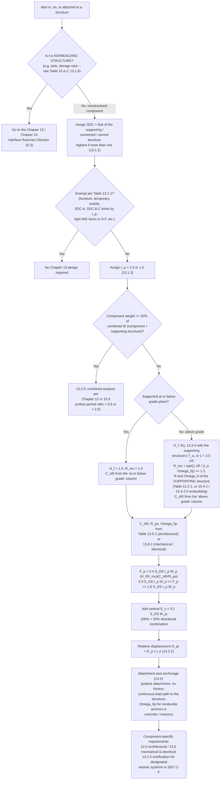
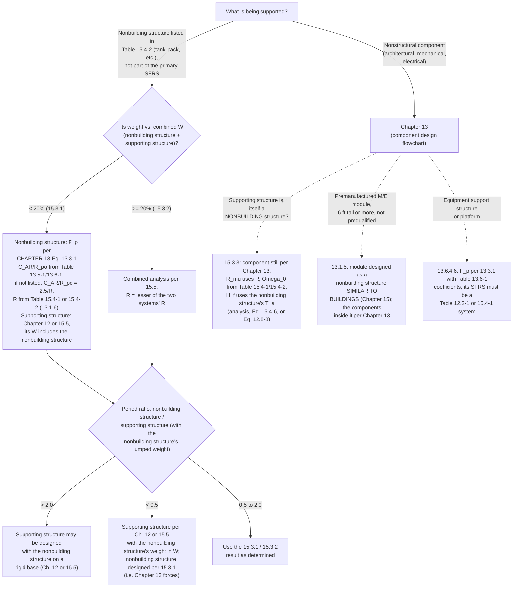

# Nonstructural Components and Nonbuilding Structures (ASCE 7-22 Chapters 13 and 15, §11.9)

This file covers seismic demands on nonstructural components (ASCE 7-22
Chapter 13), nonbuilding structures (Chapter 15), the interface between the
two, and the §11.9 vertical ground motions. Read it when the set shows heavy
equipment, rooftop units, tanks, screens, racks, platforms, or any other item
supported by the building. The reviewer confirms that each item is classified
correctly (Chapter 13 component, or Chapter 15 combined/coupled system), that
its anchorage and its path into the diaphragm or frame are shown, and that
the F_p demands on the anchorage follow ASCE 7-22.

## Why this matters to the lateral load path

Most nonstructural components sit outside the building's SFRS, but they tie
into the load path in three ways:

- **Heavy items change the building's own analysis.** At or above 20% of
  the combined weight, a component (§13.2.9) or nonbuilding structure
  (§15.3.2) is analyzed together with its support, which changes the
  building's period, mass distribution, and R.
- **Anchorage and local elements (§13.4).** F_p needs a continuous path
  into the structure, and the local members and connections it attaches to
  must be designed for the component forces where those control. A rooftop
  unit's F_p must reach the roof framing and then the diaphragm.
- **Edition recognition.** Notes or calcs using a_p, R_p, and (1 + 2z/h)
  follow the ASCE 7-16 method; flag as superseded on a 7-22 project.

**Key review questions for every supported item:**

1. Nonstructural component (Chapter 13), or nonbuilding structure (Table
   15.4-2 item, so Chapter 15 via §13.1.6 → §15.3)?
2. Below or at/above 20% of the combined effective seismic weight? If at or
   above, is a combined analysis or a period-ratio exception shown?
3. Are the anchorage and its path into the diaphragm or frame shown?
4. Are H_f, R_μ, C_AR, R_po, Ω₀p the 7-22 terms, from the correct structure
   and table column?

## What changed from ASCE 7-16

ASCE 7-22 **replaces** the F_p equation. The 7-16 column is only for
recognizing a set still designed to it.

| Item | ASCE 7-16 (older projects / existing reports) | ASCE 7-22 |
|---|---|---|
| Equation | F_p = 0.4·a_p·S_DS·W_p·(1 + 2z/h) / (R_p/I_p) | **F_p = 0.4·S_DS·I_p·W_p·(H_f / R_μ)·(C_AR / R_po)** (Eq. 13.3-1) |
| Height amplification | (1 + 2z/h), same for every building | **H_f**, which depends on the supporting structure's period (Eq. 13.3-4), or 1 + 2.5·z/h (Eq. 13.3-5) |
| Supporting structure ductility | Not considered | **R_μ** = [1.1·R / (I_e·Ω₀)]^½ ≥ 1.3 (Eq. 13.3-6), using the supporting structure's R and Ω₀ |
| Component amplification | a_p | **C_AR** (component resonance ductility factor), with separate values for components at/below grade and above grade |
| Component response modification | R_p | **R_po** (component strength factor) |
| Anchor overstrength | Ω₀ | **Ω₀p** (anchorage overstrength factor, Tables 13.5-1 / 13.6-1) |
| Upper / lower bound | 1.6·S_DS·I_p·W_p / 0.3·S_DS·I_p·W_p | Same (Eqs. 13.3-2, 13.3-3) |
| Heavy-item threshold (nonbuilding structure on another structure) | 25% of combined weight | **20%** (§15.3.1, §15.3.2), the same as Chapter 13 (§13.1.1, §13.2.9) |
| Link to Chapter 15 | Loose | **Explicit.** The same equation serves nonbuilding structures supported by other structures (§13.1.6, §15.3), and R_μ and H_f can come from a nonbuilding supporting structure |
| Nonbuilding structure seismic coefficient tables | "Table 15.1-1" (7-16 numbering) | Table 15.4-1 (similar to buildings), Table 15.4-2 (not similar); procedure selection in the text of §15.1.3 |
| Vertical spectrum (§11.9) | Built on S_MS | Built on S_aM / F_md, with a longitude rule (see §11.9 below) |

## The F_p equation, term by term (ASCE 7-22 §13.3.1)

**F_p = 0.4·S_DS·I_p·W_p·(H_f / R_μ)·(C_AR / R_po)** (Eq. 13.3-1)

- **Bounds:** 0.3·S_DS·I_p·W_p ≤ F_p ≤ 1.6·S_DS·I_p·W_p (Eqs. 13.3-2, 13.3-3).
- Applied at the component's center of gravity, distributed by its mass.
  **ρ = 1.0** is permitted.
- **Direction:** the most critical direction, or the more severe of 100% in
  one direction + 30% perpendicular and that pair rotated 90°.

| Term | Meaning | Source |
|---|---|---|
| S_DS | Short-period design spectral acceleration | §11.4.5 |
| I_p | Component importance factor: **1.5** if the component is needed for life safety after an earthquake (sprinklers, egress stairs), contains hazardous, toxic, or explosive material above the AHJ threshold, is needed for an essential facility in a Risk Category IV structure (or its failure would impair one), or contains hazardous substances in a hazardous occupancy. Otherwise **1.0** | §13.1.3 |
| W_p | Component **operating** weight | — |
| H_f | Amplification with height | §13.3.1.1 |
| R_μ | Supporting structure ductility reduction | §13.3.1.2 |
| C_AR | Component resonance ductility factor | Table 13.5-1 (architectural); Table 13.6-1 (mechanical/electrical, distribution systems and their supports, equipment support structures) |
| R_po | Component strength factor | Tables 13.5-1, 13.6-1 |
| Ω₀p | Anchorage overstrength factor | Tables 13.5-1, 13.6-1 |

The component's SDC is that of the supporting, connected, or served
structure. If more than one applies, use the highest (§13.1.2).

### H_f: amplification with height (§13.3.1.1)

- Supported **at or below grade plane**: **H_f = 1.0**.
- Supported **above grade** by a building or nonbuilding structure, either:
  - **H_f = 1 + a₁·(z/h) + a₂·(z/h)^10** (Eq. 13.3-4), with
    **a₁ = 1/T_a ≤ 2.5** and **a₂ = [1 − (0.4/T_a)²] ≥ 0**.
  - **H_f = 1 + 2.5·(z/h)** (Eq. 13.3-5). This form is permitted at any
    time, and it is the one to use when T_a is unknown.
- z = attachment height above the base (0 at or below it); h = average roof
  height above the base. **z/h need not exceed 1.0.**
- T_a = the **lowest** approximate period of the supporting structure in
  either direction (Eq. 12.8-8 for buildings). With combined SFRSs, use the
  SFRS that gives the lowest T_a. If the SFRS is unknown, use the "all other
  structural systems" parameters.
- For a **nonbuilding** supporting structure, T_a may come from (a) a
  substantiated analysis per §12.8.2, (b) Eq. 15.4-6, or (c) Eq. 12.8-8
  with the "all other structural systems" parameters.

### R_μ: supporting structure ductility (§13.3.1.2)

**R_μ = [1.1·R / (I_e·Ω₀)]^½ ≥ 1.3** (Eq. 13.3-6)

- R, Ω₀, and I_e belong to the **supporting** building or nonbuilding
  structure, not the component. They come from Table 12.2-1 (buildings) or
  Table 15.4-1 / 15.4-2 (nonbuilding structures).
- At or below grade plane: **R_μ = 1.0**.
- SFRS not specified, or not listed in those tables: **R_μ = 1.3** above
  grade, unless the AHJ approves other parameters.
- Combinations of SFRSs (different directions or vertical combinations):
  use the SFRS giving the **lowest** R_μ for the whole structure.

### C_AR and R_po (§13.3.1.3, §13.3.1.4)

- Architectural components: Table 13.5-1. Mechanical/electrical
  components: Table 13.6-1.
- Each table gives C_AR separately for components **supported at or below
  grade plane** and components **supported above grade plane by a
  structure**.
- **Equipment on an equipment support structure or platform:** the
  equipment's C_AR is not less than the platform's C_AR. The platform's
  C_AR follows §13.6.4.6; its SFRS must be a Table 12.2-1 or 15.4-1 system;
  and the platform's W_p includes the equipment it carries.
- **Distribution systems** (pipe, duct, raceway): the system itself takes
  C_AR from Table 13.6-1. Its **supports** take their own C_AR by support
  type (§13.6.4.7).

### Other demands

- **Vertical (§13.3.1.6):** concurrent E_v = 0.2·S_DS·W_p (§12.4.2.2),
  except lay-in access floor and ceiling panels.
- **Nonseismic loads (§13.3.1.7):** if they exceed F_p they govern
  strength, but Chapter 13 detailing still applies.
- **Nonlinear response history alternative (§13.3.1.5):** F_p =
  I_p·W_p·a_i·(C_AR/R_po), a_i = mean peak floor acceleration from at least
  seven ground motions; same bounds.
- **Relative displacement (§13.3.2):** **D_pI = D_p·I_e** (Eq. 13.3-8).
  - Within one structure: D_p = δ_xA − δ_yA (δ_DE values per Eq. 12.8-16).
    It need not exceed (h_x − h_y)·Δ_aA/h_sx when the structure meets its
    drift limit.
  - Between two structures: D_p = |δ_xA| + |δ_yB|. It need not exceed
    h_x·Δ_aA/h_sx + h_y·Δ_aB/h_sx.
- **Component period (§13.3.3):** T_p = 2π·√(W_p / (K_p·g)) for a simple
  spring-mass idealization, or from test data or analysis.
- **Load combinations (§13.2.2):** F_p is used as E_h (§12.4.2.1). The
  overstrength combinations (§12.4.3) use **Ω₀p** (§13.4.2). Where a
  reference document uses ASD, multiply F_p by 0.7 (§13.1.8).
- **Certification by analysis, designated seismic systems (§13.2.3):**
  C_AR/R_po = 2.5 and R_μ = 1.3 above grade (C_AR/R_po may be 1.0 if
  T_p ≤ 0.06 s).
- **Testing alternative (§13.2.6):** demand need not exceed 3.2·I_p·W_p.

### Heavy components and the combined-system R (§13.2.9)

- At **20% or more** of the combined weight (component + supporting
  structure), analyze them together per Chapter 12 or §15.5, unless the
  period ratio is below 0.5 or above 2.0.
- As printed, the combined R is the lesser of "0.40·[C_AR/R_po]" of the
  component and the supporting structure's R. This term looks inverted:
  §13.1.6 equates C_AR/R_po with 2.5/R, implying an equivalent R of
  2.5/[C_AR/R_po] = 1/(0.40·[C_AR/R_po]), and the printed form gives very
  small R (C_AR = 2.2, R_po = 1.5 → 0.59) (verify against ASCE 7-22
  errata). If a calc uses it, note which form was used.

### Attachment and anchorage (§13.4)

- **Positive attachment**, no reliance on friction; a **continuous load
  path** from the component to the structure.
- **Ω₀p** for nonductile anchors in concrete or masonry (§13.4.2).
- **Local elements** (the members and connections the component attaches
  to) are designed for the component forces where those control.
- Component-specific requirements: §13.5 (architectural), §13.6 (M/E);
  designated seismic systems in SDC C–F need certification (§13.2.3).

### Exempt components (Table 13.1-1)

Table 13.1-1 lists exemptions: furniture, temporary and mobile items;
components in SDC A; SDC B–C items with limits based on I_p; and light
mechanical/electrical items in SDC D–F, among others. Check the table for
the exact conditions before you accept an exemption claimed in the notes.

## Design flowchart: nonstructural component (Chapter 13)

## Interface flowchart: Chapter 13 / Chapter 15

**The five connection points:**

1. **Light nonbuilding structure on a structure (§13.1.6 → §15.3.1):**
   forces come back to Eq. 13.3-1; if untabulated, C_AR/R_po = 2.5/R
   (R from Table 15.4-1 / 15.4-2).
2. **Heavy item, ≥ 20% (§13.2.9, §15.3.2):** analyze item and support
   together, unless the period ratio is < 0.5 or > 2.0.
3. **Nonbuilding support (§15.3.3, §13.3.1.1, §13.3.1.2):** the component
   stays in Chapter 13, but R_μ and H_f come from the nonbuilding support.
4. **Modular M/E systems ≥ 6 ft, not prequalified (§13.1.5):** the module is
   a nonbuilding structure similar to buildings; its contents are Chapter 13.
5. **Equipment platforms (§13.6.4.6):** Chapter 13 forces, but the SFRS must
   be a Table 12.2-1 or 15.4-1 system, with that system's detailing and
   limits.

### What to check on the drawings / calcs (components)

- **Edition.** The 7-22 F_p equation is used; a_p, R_p, or (1 + 2z/h) is
  flagged as ASCE 7-16 on a 7-22 project.
- **Classification.** Each heavy item is identified as a nonstructural
  component (Chapter 13) or a nonbuilding structure (Table 15.4-2, so
  §15.3). A tank or rack treated as a simple component with no §15.3
  check is a finding.
- **20% check.** For each heavy item, the calcs compare its weight with
  the combined weight. At or above 20%, a combined analysis is shown or a
  period-ratio exception (< 0.5 or > 2.0) is justified, and the item's
  weight is included in the building's W.
- **R_μ and H_f.** R_μ uses the support's R, Ω₀, I_e (Table 12.2-1, or
  15.4-1 / 15.4-2), the lowest R_μ for combined systems, ≥ 1.3 above grade.
  H_f uses the support's lowest T_a or 1 + 2.5·z/h, with z/h ≤ 1.0; both
  are 1.0 only at or below grade.
- **Table column.** C_AR comes from the correct column ("at or below grade"
  vs. "above grade") and the correct table (13.5-1 architectural,
  13.6-1 M/E). The row is identified in the calcs.
- **I_p and W_p.** I_p = 1.5 for life-safety, hazardous-contents, and
  Risk Category IV essential-facility components; W_p is operating weight.
- **Bounds and combinations.** F_p is within 0.3 to 1.6·S_DS·I_p·W_p, with
  the 100% + 30% combination and concurrent E_v = 0.2·S_DS·W_p.
- **Overstrength.** Ω₀p (not the building's Ω₀) is applied to nonductile
  anchors in concrete or masonry.
- **Relative displacement.** Components connected at two levels or to two
  structures are checked for D_pI = D_p·I_e.

#### Equipment anchorage

- Anchor type, size, embedment, edge distance, and quantity are shown for
  each anchored item.
- The attachment is positive; no reliance on friction or gravity.
- Where the item sits on a pad, curb, or isolation base, the path is shown
  continuing through it into the slab or framing. A continuous load path
  to the structure is required (§13.4); an anchor that stops at an
  unattached intermediate element is a finding.
- Designated seismic systems in SDC C–F have the certification called out
  (§13.2.3).

#### Rooftop units

- A curb, frame, or rail detail shows how the unit's F_p (horizontal, plus
  overturning uplift) passes into the roof framing members.
- The roof framing members and connections at the curb (the "local
  elements") are designed for the component forces where they control.
- The path continues from the framing into the roof diaphragm (see
  `diaphragms_and_collectors.md` for the diaphragm side of the path).
- H_f uses z/h = 1.0 (roof level), with the above-grade C_AR column.
- Heavy units are checked against the 20% threshold (§13.2.9).

#### Screens and other supports

- Screen frames, platforms, and dunnage are identified as Chapter 13 items
  (table and row cited) or as §13.6.4.6 platforms with a Table 12.2-1 or
  15.4-1 SFRS, detailed to that system.
- A platform's W_p includes the equipment it carries, and the equipment's
  C_AR is not less than the platform's.
- Post bases, braces, and moment connections at the roof are detailed, and
  the reactions are traced into the roof framing and diaphragm.
- Distribution system supports (pipe, duct, raceway) use their own
  support-type C_AR (§13.6.4.7).

## Ceilings, partitions, and elevators/lifts

These components show up on almost every renovation and tenant
improvement set, usually in the architectural or MEP notes rather than
the structural sheets. Their anchorage is part of the lateral load path:
the component's F_p goes into the structure above or around it.

All provisions below are **confirmed against ASCE 7-22**. ASCE 7-16 has
the same provisions with similar numbering (verify: ASCE 7-16 numbering).

### Suspended ceilings (§13.5.6)

- **Exempt:**
  - ceilings of **144 ft² or less** surrounded by walls or soffits that are
    laterally braced to the structure above;
  - **screw- or nail-attached gypsum board** ceilings on one level,
    surrounded by and connected to braced walls or soffits.
- **Seismic weight:**
  - W_p includes the grid, the panels, and any light fixtures or other
    components attached to or laterally supported by the grid;
  - **W_p is at least 4 psf**;
  - F_p must be carried through the ceiling attachments into the
    structure or the ceiling-structure boundary.
- **Acoustical tile and lay-in ceilings.** Unless they're designed as
  integral construction (§13.5.6.3) or seismically qualified:
  - **SDC C:** ASTM C635, C636, and **ASTM E580 Section 4**.
  - **SDC D–F:** ASTM C635, C636, and **ASTM E580 Section 5**, as modified:
    - **perimeter closure angle at least 2.0 in.** wide (or qualified
      perimeter clips), positively attached to the wall studs or
      structure;
    - in each direction, **one end of the grid is attached** and **the
      other end has at least 0.75 in. clearance** and is free to slide;
    - ceiling areas **over 2,500 ft²** are broken up by seismic separation
      joints or full-height partitions into areas of 2,500 ft² or less,
      each with an aspect ratio of 4 or less. The alternative is an
      analysis showing that clearances at penetrations and closures
      accommodate the displacement.
- **Integral construction (§13.5.6.3):** the sprinkler system and ceiling
  grid may be tied together and designed as one unit by a registered
  design professional, instead of providing large clearances at sprinkler
  penetrations.

### Partitions (§13.5.8)

- Partitions **tied to the ceiling**, and **all partitions over 6 ft
  high**, must be **laterally braced to the building structure**.
- That bracing must be **independent of the ceiling bracing**. Bracing
  spacing must keep the head deflection compatible with the ceiling's
  deflection requirements.
- **Exempt:** partitions that meet all three of these:
  - **9 ft** high or less;
  - linear weight no more than **10 lb × height (ft)** per foot;
  - horizontal seismic load no more than **5 psf**.
- Glass in glazed partitions follows §13.5.9 (drift fallout check).

### Elevators, escalators, and lifts (§13.6.11)

- Elevators and escalators designed to the seismic requirements of
  **ASME A17.1** are deemed to meet the force requirements, with these
  modifications:
  - **Hoistway structures, elevator equipment, and controller supports and
    attachments** are designed for the §13.3.1 forces and the §13.3.2
    displacements.
  - **Seismic switches** are required for elevators at **150 ft/min or
    faster**.
  - **Retainer plates** are required at the top and bottom of the car and
    the counterweight.
- **Vertical and inclined platform lifts** (accessibility lifts) are
  usually covered by **ASME A18.1** rather than A17.1. Their anchorage to
  the structure is typically by the manufacturer (verify: ASME A18.1 and
  the local adoption).
  - Treat the lift as an equipment component under Chapter 13 for
    anchorage.
  - The documents should require the anchorage design, or the
    manufacturer's seismic qualification, for the project's SDC.

### What to check on the drawings / calcs (ceilings, partitions, lifts)

- **The SDC that the ceiling and partition requirements depend on is
  stated** on the drawings. If the architectural notes say "per SDC D" but
  the structural sheets give no seismic parameters, that's a design-basis
  inconsistency.
- **SDC D–F lay-in ceilings:**
  - the notes or details show the 2 in. closure angle (or qualified clips);
  - attached and free edges with 0.75 in. clearance;
  - separation joints for areas over 2,500 ft²;
  - bracing or E580 Section 5 compliance;
  - sprinkler penetration clearances or integral design.

  Manufacturer cut sheets that reproduce E580 guidance are acceptable as a
  reference, but the project-specific layout (areas, joints, bracing) still
  needs to be shown or delegated.
- **Partitions** over 6 ft or tied to the ceiling have a bracing detail
  **with fasteners and spacing**, and that detail is independent of the
  ceiling bracing. A detail saying only "brace to structure above" is an
  unconfirmed link.
- **Elevators:** the hoistway and machine or controller anchorage design
  is required, along with seismic switches where the speed is 150 fpm or
  more.
- **Platform lifts:** the submittal requirements include seismic anchorage
  design or qualification for the stated SDC, especially where an existing
  lift's "infrastructure" is reused for a new unit.

## Nonbuilding structures (ASCE 7-22 Chapter 15)

### Scope and classification

- **Scope (§15.1.1).** Chapter 15 also covers buildings whose primary
  purpose is to enclose equipment or machinery and that are occupied only
  for maintenance or monitoring.
- **Weight (§15.4.3).** W includes normal operating contents (tanks,
  vessels, bins, hoppers, piping contents), plus snow and ice where they are
  25% or more of W or where the AHJ requires.
- **I_e (§15.4.1.1)** is the largest of the reference document value, Table
  1.5-2, or elsewhere in Chapter 15.
- **Similar to buildings.** Pipe racks, steel storage racks, electrical
  power-generating facilities, structural towers for tanks and vessels,
  and piers and wharves, plus building frame and moment frame systems.
  Their R, Ω₀, and C_d are in **Table 15.4-1**, and specific provisions
  are in §15.5.
- **Not similar to buildings.** Signs, billboards, amusement structures,
  silos and chimneys, tanks and vessels, cooling towers, communication
  towers, bins and hoppers, monuments, truss towers, cantilever columns,
  and earth-retaining walls. They are listed in **Table 15.4-2**, with
  provisions in §15.6.
- **Rigid vs. nonrigid** (§15.4.2): rigid if fundamental period
  **T < 0.06 s**, nonrigid if **T ≥ 0.06 s**.
- **Self-supporting vs. supported** by another structure (e.g. a water tank
  on a building roof). Supported ones go through §15.3.
- A reference to "Table 15.1-1" uses the ASCE 7-16 numbering. In 7-22, use
  Tables 15.4-1 / 15.4-2 and §15.1.3.

### Analysis procedure (§15.1.3, §15.1.4)

- **Similar to buildings.** Use the same procedures as buildings (§12.6).
  7-22 removed the ELF restrictions from §12.6, so the designer may choose
  ELF, MRSA, or LRHA (see `seismic_design_basis.md`).
- **Not similar to buildings.** ELF (§12.8), the linear dynamic procedures
  of §12.9 (modal response spectrum, linear response history), nonlinear
  response history (Chapter 16), or the procedure in the applicable
  reference document (listed in Chapter 23).
- **Vertical ground motion (§15.1.4).** Tanks, vessels, hanging structures,
  and horizontal cantilevers **shall** use §11.9, with R = 1.0 vertically
  except for hydrodynamic hoop forces in tank walls.

### Base shear (§15.4)

| Case | Base shear | Notes |
|---|---|---|
| Rigid (T < 0.06 s) | **V = 0.30·S_DS·W·I_e** (Eq. 15.4-5) | W = operating weight. Distributed with height per §12.8.3. Applies to the **anchorage** too |
| Nonrigid, similar to buildings | V = C_s·W, C_s = S_DS·I_e/R, with the Chapter 12 upper and lower limits | R, Ω₀, C_d from Table 12.2-1 or Table 15.4-1 (§15.4.1, item 1(a)) |
| Nonrigid, not similar to buildings | V = C_s·W, C_s = S_DS·I_e/R, Chapter 12 upper limits, **plus the Chapter 15 lower limits below** | ρ = 1.0 (§12.3.4.1, item 4). R, Ω₀, C_d from Table 15.4-2 |

**Lower limits on C_s for structures not similar to buildings** (§15.4.1,
item 2, for systems with an R in Table 15.4-2):

| Condition | Minimum C_s | Compare: buildings |
|---|---|---|
| All | **C_s ≥ 0.044·S_DS·I_e, and ≥ 0.03** (Eq. 15.4-1) | 0.01 |
| S1 ≥ 0.6g | **C_s ≥ 0.8·S1/(R/I_e)** (Eq. 15.4-2) | 0.5·S1/(R/I_e) |
| Exception: tanks and vessels to AWWA D100, AWWA D103, API 650 (App. E), or API 620 (App. L); stacks and chimneys to ACI 307 (all as modified by ASCE 7) | Larger of the reference document's minimum or C_s ≥ 0.044·S_DS·I_e ≥ **0.01** (Eq. 15.4-3), and 0.5·S1/(R/I_e) where S1 ≥ 0.6g (Eq. 15.4-4) | — |

- The minimum base shear need not apply to the **convective (sloshing)**
  component of liquid in tanks.
- §15.4.1 says these limits replace "Eq. 12.8-5" and "Eq. 12.8-6." In 7-22
  those numbers are an upper-limit equation and the 0.044 lower limit, so
  the cross-references appear to be one number off after the 7-22
  renumbering. The intent is the Chapter 12 lower limits (verify against
  ASCE 7-22 errata).
- **Vertical distribution (§15.4.1, item 4):** per §12.8.3, per §12.9.1
  (modal), or per the applicable reference document.

### Drift and P-delta (§15.4.5, §15.4.6)

Under ASCE 7-22, drift and P-delta are **not** blanket exemptions for
nonbuilding structures.

- **Drift (§15.4.5).** The §12.12.1 limit applies unless a **rational
  analysis** shows it can be exceeded without affecting stability or
  attached/interconnected components (walkways, piping).
- **P-delta (§15.4.6):**
  - Similar to buildings: P-delta **is evaluated** per §12.8.7.
  - Not similar to buildings: §12.8.7 doesn't apply, but P-delta effects on
    design forces and drifts **shall be explicitly considered**, using
    elastic displacements × C_d/I_e (C_d from Table 15.4-2).
- A design that treats drift and P-delta as simply "not applicable" to a
  nonbuilding structure is a finding under 7-22.

### Exempt nonbuilding structures (§11.1.2)

ASCE 7 does not cover nonbuilding structures that need special
consideration not addressed in Chapter 15 and have their own seismic
regulations: for example **vehicular** bridges, electrical transmission
towers, hydraulic structures (dams), **buried utility lines and their
appurtenances**, nuclear reactors, and piers and wharves **not accessible to
the general public**. The list is "such as," so it isn't exhaustive, but
**tunnels are not named** in 7-22; do not accept "tunnel" as an explicit
exemption. §11.1.2 also
exempts some buildings: detached one- and two-family dwellings where
S_S < 0.4 or the SDC is A–C; detached one- and two-family wood-frame
dwellings up to two stories built to the IRC; and agricultural storage
structures with only incidental human occupancy.

### Nonbuilding structures supported by other structures (§15.3)

These rules apply to nonbuilding structures that are supported by another
structure and are **not part of the primary SFRS**. The threshold is
**20%** of the combined effective seismic weight (ASCE 7-22). The ASCE 7-16
value was 25% (older projects / existing reports). An item between 20% and
25% that was designed as a light item under 7-16 needs a combined analysis
under 7-22.

| Weight of nonbuilding structure vs. combined W | Nonbuilding structure | Supporting structure |
|---|---|---|
| **< 20% (§15.3.1)** | Forces from Chapter 13 (Eq. 13.3-1), with C_AR/R_po per §13.1.6. If not tabulated, C_AR/R_po = 2.5/R, with R from Table 15.4-1 or 15.4-2 | Chapter 12 or §15.5, with the nonbuilding structure's weight included in W |
| **≥ 20% (§15.3.2)** | Designed with its attachments for the forces from the combined analysis | Combined analysis per §15.5, with R = the **lesser** of the nonbuilding structure's and the supporting structure's R |

**Period-ratio exceptions (both cases).** The ratio is the nonbuilding
structure's period divided by the supporting structure's period (with the
nonbuilding structure's weight lumped onto the support):

- **> 2.0:** the support may be designed with the nonbuilding structure on
  a rigid base.
- **< 0.5:** design the support with the nonbuilding structure's weight in
  W, and design the nonbuilding structure per §15.3.1 (Chapter 13 forces).

**Consequences for the load path review:**

- At ≥ 20%, the building's period, base shear, R, and force distribution
  reflect the combined system; an analysis that leaves out the tank or rack
  is incomplete. The lesser R can drop below the design-basis R, so check
  the R in the general notes.
- At < 20%, the item's weight still belongs in the building's W, and its
  Chapter 13 force still needs a path into the diaphragm or frame.
- **Components on nonbuilding structures (§15.3.3)** are designed per
  Chapter 13, with R_μ and H_f based on the nonbuilding support.

### What to check on the drawings / calcs (nonbuilding structures)

- **Classification is stated.** Similar or not similar to buildings, rigid
  or nonrigid (with T shown, or a basis for T < 0.06 s), and self-supporting
  or supported. The R, Ω₀, and C_d cited come from Table 15.4-1 or 15.4-2,
  as appropriate.
- **Rigid structures.** V = 0.30·S_DS·W·I_e is used for the structure
  **and its anchorage**, with W as the operating weight.
- **Not-similar structures.** ρ = 1.0. The Chapter 15 C_s minimums (0.03
  floor, 0.8·S1/(R/I_e) where S1 ≥ 0.6g) are used, not the building
  minimums, unless the tank/vessel/stack reference-document exception
  applies and is cited.
- **I_e** is the largest of the governing values (§15.4.1.1).
- **Drift and P-delta.** Drift limit met or exceedance supported by a
  rational analysis; P-delta evaluated (similar) or explicitly considered
  (not similar).
- **Vertical ground motion.** Tanks, vessels, hanging structures, and
  horizontal cantilevers use the §11.9 vertical spectrum with R = 1.0
  (except hydrodynamic hoop forces).
- **Exemptions.** Any exemption claimed matches §11.1.2.
- **Supported structures.** The 20% check is shown, the correct §15.3.1 or
  §15.3.2 path is followed, and any period-ratio exception is backed by
  calculated periods.

#### Tanks

- W uses operating (full) weight; the tank's own R is from Table 15.4-2.
- Anchorage is shown, and its demand matches the governing path (rigid V,
  nonrigid V, or Chapter 13 F_p).
- On a building: the 20% check is shown. Below 20%, F_p uses
  C_AR/R_po = 2.5/R if untabulated; at 20% or more, the building analysis is
  combined with the lesser R.
- The support (legs, dunnage, slab) and its connection into the roof or
  floor framing and diaphragm are detailed.
- The §11.9 vertical spectrum is used; any minimum-base-shear relief is
  limited to the convective component.

## Vertical ground motions (ASCE 7-22 §11.9)

### When it applies (§11.9.1)

- Applies to **SDC C–F**. **Optional** in general: used **in lieu of**
  E_v = 0.2·S_DS·D (§12.4.2.2), giving E_v = 0.3·S_av·D (Eq. 12.4-4b).
- **Mandatory** for tanks, vessels, hanging structures, and horizontal
  cantilevers (§15.1.4).
- **Geography.** The §11.9.2 spectrum applies in the conterminous US **at
  or west of −105° longitude**, plus Alaska, Hawaii, Puerto Rico, USVI,
  Guam/Northern Mariana Islands, and American Samoa. **East of −105°**:
  S_aMv = **2/3 × S_aM** (no spectrum shape).

### MCE_R vertical response spectrum (§11.9.2)

The spectrum is built from the horizontal multi-period MCE_R spectral
acceleration at the same period, **S_aM**, divided by **F_md**:

| Vertical period T_v | S_aMv |
|---|---|
| T_v ≤ 0.025 s | 0.65·C_v·(S_aM/F_md) |
| 0.025 < T_v ≤ 0.05 s | 16·C_v·(S_aM/F_md)·(T_v − 0.025) + 0.65·C_v·(S_aM/F_md) |
| 0.05 < T_v ≤ 0.1 s | 1.05·C_v·(S_aM/F_md) |
| 0.1 < T_v ≤ 2.0 s | 1.05·C_v·(S_aM/F_md)·(0.1/T_v)^0.5, but not less than 0.5·(S_aM/F_md) |
| T_v > 2.0 s | 0.5·(S_aM/F_md) |

- **C_v (Table 11.9-1):** the vertical coefficient, by **S_MS** and the 7-22
  site classes (A/B, BC, C, CD, D/DE/E/F). It ranges from 0.7 (S_MS ≤ 0.2)
  up to 1.5 (S_MS ≥ 2.0, Site Class D–F). Interpolate between rows. The
  §11.9.2 text says C_v is "defined in terms of S_S," but the table is laid
  out by S_MS. One row reads "S_MS = 12.0," almost certainly 1.2 (verify
  against ASCE 7-22 errata).
- **F_md (maximum-direction factor):** converts between geometric-mean and
  maximum-direction spectral ordinates.
  - 1.2 for T_v ≤ 0.2 s
  - 1.2 + 0.0625·(T_v − 0.2) for 0.2 < T_v ≤ 1.0 s
  - 1.25 + 0.05·(T_v − 1.0)/9 above 1.0 s. The standard prints this range
    as "1 < T_v ≤ 1.0 s"; from context it is the range above 1.0 s, likely
    up to 10 s (verify against ASCE 7-22 errata).
- A site-specific study is permitted, but not less than **80%** of the
  equation values.

### Design vertical response spectrum (§11.9.3)

**S_av = 2/3 × S_aMv.**

### ASCE 7-16 (older projects / existing reports)

The 7-16 vertical spectrum was built on **S_MS**, not S_aM/F_md. Other
recognition features: short-period ordinates of 0.3·C_v·S_MS and a
0.8·C_v·S_MS plateau with a (0.15/T_v)^0.75 decay; C_v by S_S and the old
site classes; no F_md; no longitude rule; and breakpoints at
0.025 / 0.05 / 0.15 / 2.0 s (verify: ASCE 7-16 §11.9). If a vertical
spectrum uses S_MS directly, or has a 0.15 s breakpoint, it was built to
7-16 and must be redone to 7-22 for a 7-22 project.

### What to check on the drawings / calcs (vertical)

- Tanks, vessels, hanging structures, and horizontal cantilevers use §11.9,
  not E_v = 0.2·S_DS·D alone. Elective use: E_v = 0.3·S_av·D, SDC C–F.
- The spectrum uses S_aM/F_md, C_v from Table 11.9-1 with the 7-22 site
  class, and the correct longitude branch (full spectrum at or west of
  −105°, 2/3·S_aM east of it).
- Any site-specific vertical spectrum is not less than 80% of the equation
  values.

## Common findings

- Component F_p uses the ASCE 7-16 equation (a_p, R_p, 1 + 2z/h) on a 7-22
  project, or a "Table 15.1-1" citation shows 7-16 numbering.
- A supported nonbuilding structure is checked at the 7-16 25% threshold
  instead of 20%, or no weight check is shown.
- A heavy item (≥ 20%) is left out of the building analysis, or the
  combined R is not the lesser of the two systems' R.
- R_μ uses the component's factors instead of the support's R, Ω₀, I_e, or
  falls below 1.3 above grade.
- C_AR is from the "at or below grade" column for a roof- or floor-mounted
  item; W_p or W is empty weight rather than operating weight.
- Ω₀p is missing on nonductile anchors in concrete or masonry; anchorage
  relies on friction, or no anchorage detail is shown.
- An RTU, screen, or tank has an anchorage detail but no path from the curb
  or post into the roof framing and diaphragm, and the local framing is not
  checked for the component force.
- A nonbuilding structure ignores drift without a rational analysis, or
  ignores P-delta for a structure not similar to buildings.
- A not-similar structure uses the 0.01 building C_s minimum instead of 0.03
  (and 0.8·S1/(R/I_e) where S1 ≥ 0.6g) without a qualifying exception.
- A tank or vessel uses E_v = 0.2·S_DS·D instead of §11.9, or the vertical
  spectrum is the 7-16 S_MS-based form.
- Calcs use the printed §13.2.9 "0.40·[C_AR/R_po]" combined R without
  noting the apparent inversion (verify against ASCE 7-22 errata).
